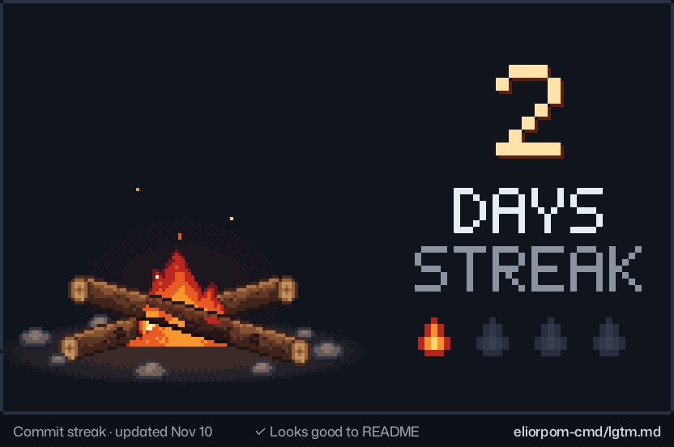
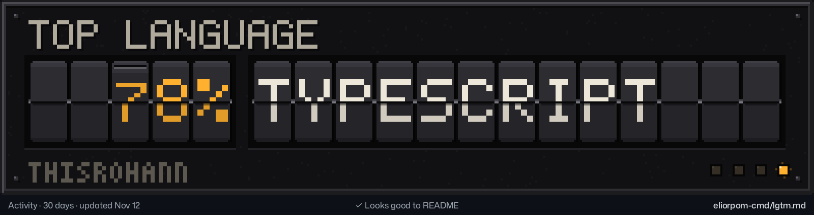

```console
$ whoami
Rohan · Mumbai · AIML engineer

$ ls ~/now
ira/    medihub/    medexplain/
```

I build AI products end to end: architecture, models, app and deployment. Mostly in healthcare and agriculture.

I work mainly in Python and TypeScript. Computer vision, RAG pipelines and multilingual NLP on the AI side; React Native, React and Supabase on the app side.

<p>


</p>

<a href="https://github.com/eliorpom-cmd/lgtm.md"></a>

<a href="https://github.com/eliorpom-cmd/lgtm.md"></a>
<a href="https://github.com/eliorpom-cmd/lgtm.md"></a>

## Projects

<table>
<tr>
<td width="64"></td>
<td><b>Ira</b><br>An AI agricultural assistant for farmers. It diagnoses crop disease from photos with computer vision and a RAG pipeline, and adds soil health checks, farm planning, a warehouse locator, NPK and pesticide calculators, and text-to-speech.</td>
</tr>
<tr>
<td width="64"></td>
<td><b>MediHub</b><br>An AI medical assistant that identifies medicines, scans handwritten prescriptions, checks drug interactions and analyzes symptoms. Its MedExplain engine rewrites diagnostic reports in plain language, in English, Hindi and Marathi.</td>
</tr>
</table>

## Also

Studying Computer Science and Engineering (AIML) at VIVA Institute of Technology, Mumbai University, class of 2027. I also did digital marketing and SEO at Fixmate Hub LLP, which taught me to read campaign data.

## Elsewhere

[LinkedIn](https://www.linkedin.com/in/rohan-yadav-650284211)

<sub>Made with <a href="https://github.com/eliorpom-cmd/lgtm.md">LGTM.md</a></sub>
